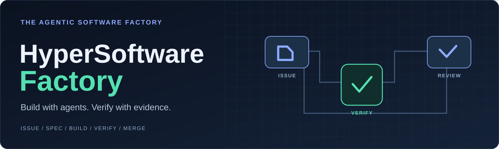
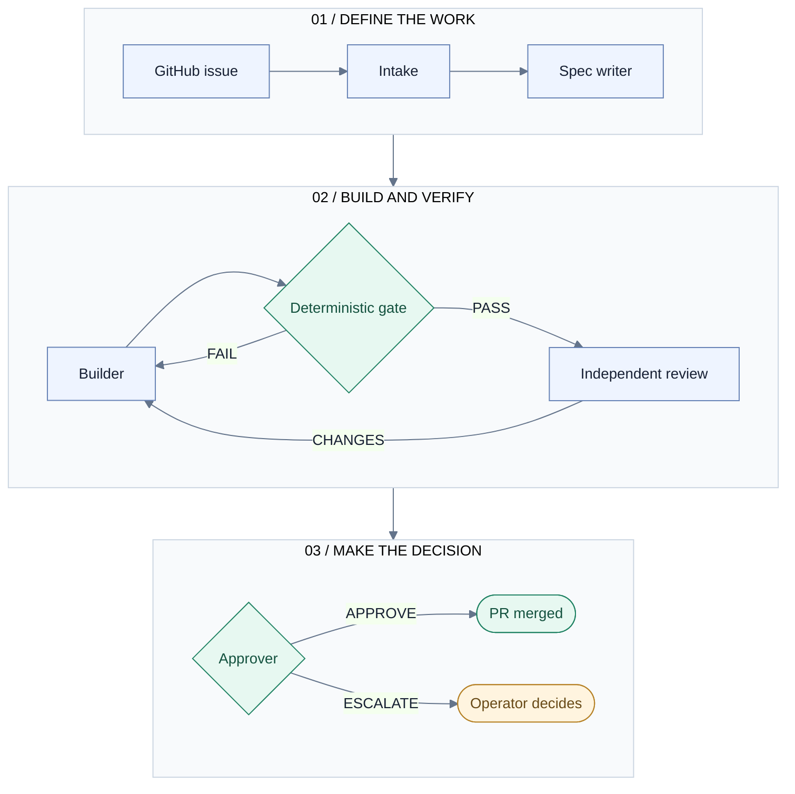
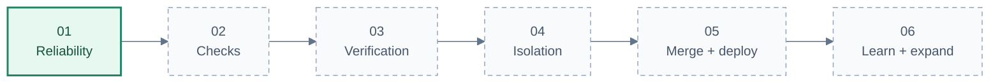
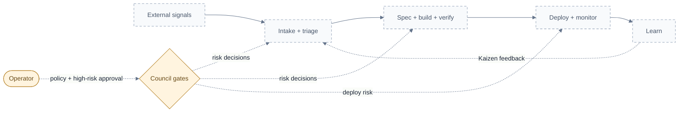

<div align="center">



# HyperSoftwareFactory

**An agent-driven software factory. An evidence-led path to autonomy.**

Turn GitHub issues into built, checked and independently reviewed pull requests.<br>
Earn more autonomy through measured results, not bigger promises.

[](reference/binley/pilot-report-2026-11-21.md)
[](#roadmap)
[](requirements.txt)
[](https://claude.com/claude-code)
[](LICENSE)
[](factory/LICENSE)

[Overview](#summary) &nbsp; / &nbsp; [Workflow](#the-working-factory) &nbsp; / &nbsp; [Quick start](#quick-start) &nbsp; / &nbsp; [Roadmap](#roadmap) &nbsp; / &nbsp; [Architecture](#target-architecture) &nbsp; / &nbsp; [Contributing](#contributing)

</div>

---

## Summary

HyperSoftwareFactory coordinates specialist agents around one work request: understand the issue, define the scope, build the change, verify it, then merge or ask a human.

| Build deliberately | Verify independently | Earn autonomy |
| :--- | :--- | :--- |
| One issue, one pull request, one job record. Intake and spec come before code. | A deterministic gate and routed code, security, UI and UX reviewers check the result. | Expand automation only when real jobs meet the roadmap's exit criteria. |

> [!IMPORTANT]
> **This is a working pilot, not a production-autonomy claim.** The pipeline lives in `factory/` and `.claude/`. External signal intake, council gates, deployment, monitoring and automated Kaizen remain target architecture in `reference/`.

### Evidence, not just a demo

| Recorded by 22 Nov 2026 | What it tells us |
| :--- | :--- |
| **11 jobs** on the Binley demonstrator | The pipeline has been exercised on one project, not validated across projects. |
| **1 unattended merge** in the first overnight run | The factory can complete the flow; a fresh install still needs a merge-policy decision. |
| **1 CHANGES round; 5 escalations** in that run | Review feedback and human handoff have been exercised. |
| **No gate-failing job in the recorded cohort** | Step 1's reliability evidence is still incomplete. |

The initial pilot reached an approved PR in **38 minutes** at **$4.45 API-equivalent agent cost**, then merged by hand after a Windows gate fault. The figure excludes the orchestrator and uses prices that were not independently verified. Read the [pilot report](reference/binley/pilot-report-2026-11-21.md) for the evidence and limitations.

## The working factory

A GitHub issue labelled `factory` enters a staged pipeline. Each issue gets one PR and a worktree. State lives in `factory/jobs/`, with `factory/bin/job` as the only writer of `job.json`.



**Gate:** the main checkout's `checks.sh` and protected-path rules.<br>
**Review:** code plus security, UI and UX reviewers as routed by risk and surface.<br>
**Recovery:** at most three build rounds before escalation; a BLOCKED review goes directly to a human.

The diagram groups the main stages. The scripts enforce the detailed transitions. The current gate still has a [known protected-path gap](#now).

## Quick start

### 1. Install into a project

Copy `factory/` and `.claude/` into the target repository, then configure the project before running jobs. The root `.gitignore` is not copied, so add `factory/jobs/` and `.worktrees/` to the target repository's `.gitignore` yourself; otherwise job state and worktrees can show up as untracked files and be swept into a broad `git add`.

| Configure | What to do |
| :--- | :--- |
| [`factory/checks.sh`](factory/checks.sh) | Add the project's tests, lint and build. The template deliberately fails until configured. |
| [`factory/config.json`](factory/config.json) | Set `base_branch` to the target repository's default branch (`main` here; a repository on `master` must change it, or jobs cannot create their worktree). Also set protected paths, models, prices and the review dev-server command. `{port}` is filled in per job. Next.js is the default; remove `dev_server` if there are no pages. |
| `AGENTS.md` or `CLAUDE.md` in the target repo | Describe the project, its scope, commands and conventions for intake and the other agents. Commit and push them to the configured `base_branch`: each job's worktree starts from `origin/<base_branch>`, so instructions that exist only locally are not seen. |
| Merge policy and Git authentication | Decide who merges and authenticate Git for the checkout. Fresh installs do not include Binley's unattended-merge permission rule. |

Use [`reference/binley/`](reference/binley/) as a worked example, including its checks and configuration. For Windows, see the [setup and operating notes](reference/binley/running-the-factory.md).

### 2. Run the pipeline

Label an open GitHub issue `factory`, then invoke the project's Claude Code skill:

```text
/factory run
```

This runs every eligible labelled issue through the pipeline. `/factory run <issue-number>` runs one issue. Before it starts, `/factory run` also adds the `factory` label to any open issue labelled `ready-for-agent` with no open blockers, so those issues can start in the same run. Tell people this before they run the command.

### 3. Follow the work

**One project's board**, from its repository root:

```bash
cd factory
python -m http.server --bind 127.0.0.1
```

Open [localhost:8000/dashboard.html](http://localhost:8000/dashboard.html) for stages, gate and reviewer verdicts, cost, time and the job's files.

**All registered projects**, from this repository root:

```bash
pip install -r requirements.txt
python scripts/factory-dashboard.py
```

Open [localhost:8020](http://localhost:8020/). Each project gets a tab with running jobs and human handoffs. Set its local checkout `path:` in `config/projects.yaml`.

## Roadmap

**Current focus: Step 1, make the skeleton reliable.** More features do not earn more autonomy. Each step has a measurable exit criterion in the [build plan](reference/build-plan.md); do not advance until the preceding step has exited.



*Green: current milestone. Dashed: later milestones, not completed capabilities.*

| Step | Outcome | Status |
| :--- | :--- | :--- |
| **0 / Foundation** | Docs, licences and a project-neutral install | Mostly done; project-specific agent instructions remain |
| **1 / Reliability** | Merge policy, Git sign-in, job time and USD caps, branch protection | **In progress.** Recorded CHANGES and escalations; still needs a gate-failing job and the caps |
| **2 / Checks** | Complexity delta, secret scanning and dependency auditing | Not started |
| **3 / Verification** | Review evidence, unchanged reviewer worktrees, spec-only testing | Partial: browser workflow and a shared review server exist |
| **4 / Isolation** | Dedicated clone, daily budget and measured concurrency increases | Partial: Windows lock waiting and child-process cleanup exist |
| **5 / Merge + deploy** | Path-based risk floor, LOW-tier automation, HIGH-tier human approval, rollback | Not started |
| **6 / Learn + expand** | Second project, external intake, event log, Kaizen and councils if justified | Not started |

### Now

- **Finish making the agents project-neutral.** `approver.md`, `reviewer-ui.md` and `reviewer-ux.md` still name Binley's fictional label, demo bar and audience.
- **Resolve the merge policy for fresh installs.** Binley's `.claude/settings.json` contains the unattended-merge rule proven on 22 Nov; it was not part of the import.
- **Close the protected-path gap.** The gate skips new files under protected globs and does not check rename destinations. A new `.github/workflows/*.yml` can pass this check.
- **Bring back Binley's later hardening.** Sensitive-path security routing and the review `## Evidence` requirement landed there after the import.
- **Finish Step 1.** Exercise a gate-failing job, enforce per-job time and USD caps, and collect the exit-criterion evidence.

### Later

Parallel builders, council debates, Prometheus, microVMs, Context7 and Modern Web Guidance stay deferred until measured failures justify them. The [build plan](reference/build-plan.md#deliberately-deferred) explains the triggers.

## Target architecture

**Design direction, not today's deployment.** The target connects external signals to monitored software, with a human retaining policy and high-risk decisions.



*Dashed boxes: target capabilities. Amber: human and council oversight. Delivery combines existing stages with verification that is still planned.*

The full design has **8 stages, 3 council gates, 1 weekly Kaizen review and 5 security boundaries**. Council gates are advisory; high-risk changes require operator approval.

<details>
<summary><strong>Explore the target design and its constraints</strong></summary>

### Signal intake

Social links, bug reports, feedback and alerts enter a triage queue. External content is untrusted: a tool-less model call summarises it into a fixed schema before an agent with tools sees it.

### Council gates

- **Fast Council:** Chair-only triage and medium-risk decisions.
- **Full Council:** Chair, Strategist, Pragmatist and Builder for architecture review.

Councils are deferred until the data shows a single agent's judgment is the weak point.

### Build and independent verification

Claude Code builds in an isolated worktree with at most three review-fix cycles. Parallel builders come later, on disjoint modules only.

The target verification layer includes a spec-only tester, code reviewer, complexity check, security scanner and behavioural verifier. Reviewers should run with read-only credentials and be unable to change the branch; this is not yet fully enforced.

### Security boundaries

| Boundary | Target protection |
| :--- | :--- |
| **Isolation** | Agents cannot touch the host or other projects |
| **Egress** | Default-deny networking with an allowlist |
| **Supply chain** | Unapproved package hosts blocked |
| **Credentials** | Real secrets kept outside the sandbox |
| **Budget** | Hard USD/token/time caps and pinned model versions |

### Observability and Kaizen

One append-only event per stage transition feeds a weekly report on failures, cost, cycle time, escape rate and human-edit rate. The report identifies improvements rather than automatically expanding scope.

### Hard constraints

1. **No unreviewed output:** every PR has at least one independent verifier.
2. **Evidence over a bare PASS:** missing evidence means INCONCLUSIVE.
3. **Complexity backpressure:** an increase above 50% on touched files blocks the PR for architecture review.
4. **Bounded review loops:** at most three rounds before escalation.
5. **Secrets outside the sandbox.**

The working scripts enforce the review requirement and default round limit today. The remaining constraints are targets, not claims about the current install.

</details>

## Autonomy levels

Autonomy is an operating result, not a feature toggle.

| Level | What the factory earns | Evidence required |
| :--- | :--- | :--- |
| **L1 / Assisted delivery** | Issue to approved PR; a human merges | Step 1 exit |
| **L2 / Measured verification** | Delivery with reviewers measured against human review | Step 3 exit |
| **L3 / Controlled automation** | LOW-tier merge and deploy; HIGH-tier work stops for a human | Step 5 exit |
| **L4 / Signal to software** | LOW-tier signals reach production without human intervention | Step 6 exit, sustained for four weeks |

> [!NOTE]
> **Working toward L1.** An unattended merge demonstrates capability, not earned autonomy. Step 1's exit criteria are not yet met.

## Documentation

| Start here | What it covers |
| :--- | :--- |
| [Build plan](reference/build-plan.md) | Current gaps, ordered milestones and measurable exit criteria |
| [Pilot report](reference/binley/pilot-report-2026-11-21.md) | Actual outcomes, costs, failures and limitations |
| [Reference architecture](reference/software-factory-reference-architecture.md) | Target stages, gates, trust boundaries and observability |
| [Windows operating notes](reference/binley/running-the-factory.md) | Setup and operation of the first demonstrator |
| [Multi-project architecture](reference/factory-multi-project-architecture.md) | The planned relationship between installs and the registry |

<details>
<summary><strong>Repository map, project registry and planned integrations</strong></summary>

### Contents

| Path | Purpose |
| :--- | :--- |
| [`factory/`](factory/) | State machine, deterministic gate, routing, frontier and live dashboard |
| [`.claude/agents/`](.claude/agents/) | Intake, spec, build, reviewer and approver definitions |
| [`.claude/skills/`](.claude/skills/) | `/factory run` and vetted skills for the build floor |
| [`reference/binley/`](reference/binley/) | Pilot evidence and worked project configuration |
| [`reference/`](reference/) | Target architecture, build plan and planned integrations |
| [`config/`](config/) and [`scripts/`](scripts/) | Local project registry, onboarding and multi-project dashboard |

### Project registry

```bash
pip install -r requirements.txt
python scripts/factory-onboard.py --interactive
```

The local `config/projects.yaml` is gitignored because it names projects and paths on your machine. See [`config/projects.example.yaml`](config/projects.example.yaml).

Onboarding registers a project and writes draft roadmap files and a README to `onboarding/<slug>/` for you to review and copy. The README uses [`config/README.template.md`](config/README.template.md). Nothing is pushed. The repository check requires an authenticated GitHub CLI (`gh auth login`).

The per-project factory does **not** read this registry. Only the multi-project dashboard uses it to locate project boards.

### Planned integrations

None is wired in yet. These are the vendors' intended capabilities, not measured benefits for this factory.

| Tool | Stage | Intended use |
| :--- | :--- | :--- |
| [Context7](reference/context7-docs-mcp.md) | Build | Current, version-specific library documentation |
| [Modern Web Guidance](reference/modern-web-guidance-google-mwg.md) | Build + verify | Web-platform practices and Baseline awareness |
| Crawl4AI | Intake research | JavaScript-rendered page extraction |

</details>

## Development

Install dependencies with `pip install -r requirements.txt`, then run:

```bash
python scripts/test_factory_onboard.py
python scripts/test_factory_dashboard.py
python factory/test_factory.py
```

The factory script checks exercise the Windows process and locking patches and must run on Windows. The checks for an installed project's application belong in that project's `factory/checks.sh`.

## Contributing

1. Read the [reference architecture](reference/software-factory-reference-architecture.md) and [build plan](reference/build-plan.md).
2. [Open an issue](https://github.com/harry738/HyperSoftwareFactory/issues) to discuss a proposed change.
3. Submit a pull request with tests and evidence.

---

### Origin and licence

Synthesised from public material on agentic software development: Factory.ai, Claude Code, Islo's security architecture, Matt Pocock's skills, Lauren Tan's Poteto Mode and Dexter Horthy's talk on software factories.

**[MIT](LICENSE)**, except `factory/`, `.claude/agents/` and `.claude/skills/factory/`, which are **[GPLv3](factory/LICENSE)**, imported from zazencodes-season-3 `src/software-factory-claude-code-v2` with local patches. Vendored skills keep their own MIT licences in `.claude/skills/`.
