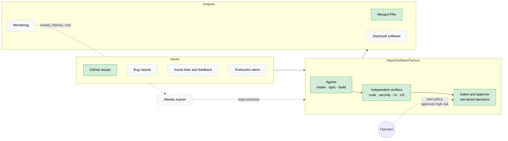
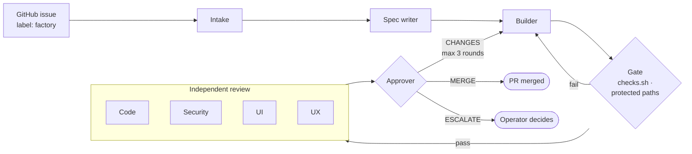
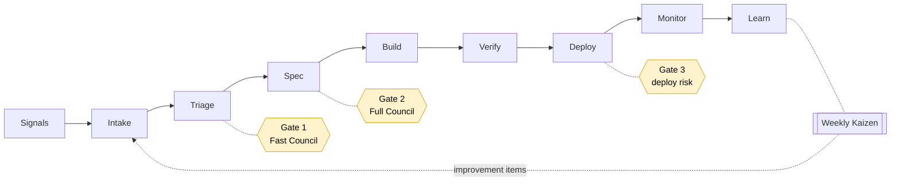
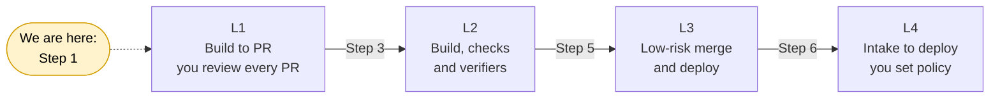

<div align="center">

# 🏭 HyperSoftwareFactory

**A software factory for building, verifying, and merging software with AI agents, and a reference architecture for where it is going.**

[](LICENSE)
[](factory/LICENSE)
[](requirements.txt)
[](https://claude.com/claude-code)
[](https://github.com/harry738/HyperSoftwareFactory/issues)
<br>
[](reference/binley/pilot-report-2026-11-21.md)
[](#autonomy-levels)
[](#roadmap)
[](https://github.com/harry738/HyperSoftwareFactory/commits/main)

[Summary](#summary) · [Working factory](#the-working-factory) · [Roadmap](#roadmap) · [Architecture](#target-architecture) · [Autonomy](#autonomy-levels) · [Contributing](#contributing)

</div>

---

## Summary

HyperSoftwareFactory turns work requests into reviewed, merged pull requests with a team of AI agents, and earns more autonomy only as measured jobs prove it safe.

- **Today:** a GitHub issue labelled `factory` goes through intake, spec, build, a deterministic gate, independent reviewers (code, security, UI, UX) and an approver. Each issue becomes one PR, which is merged, sent back for changes, or escalated to a human.
- **Tomorrow:** raw signals (social links, bug reports, feedback, alerts) come in, and deployed, monitored software goes out, with council gates on risky decisions and a weekly Kaizen loop that improves the factory from its own event log.
- **The principle:** no unreviewed output, evidence over "PASS", hard caps on loops and spend, and secrets kept outside the sandbox.

### The vision



<sub>Green: working today. Dashed: target architecture, not built yet.</sub>

> **Status.** Two things live here:
> - **A working factory** in `factory/` and `.claude/`: issue → intake → spec → build → gate → review → approve → merge. It was validated on Binley, a fictional demonstrator used to test the idea: 11 jobs, now closed (the first is written up in the [pilot report](reference/binley/pilot-report-2026-11-21.md)). It has not yet run on a real project.
> - **A plan to make it a central factory** in `reference/`: one container that serves every project, a Dev council, deploy, and a Kaizen loop. Those parts are not built. The [build plan](reference/build-plan.md) says what exists, what is next, and in what order. The [reference architecture](reference/software-factory-reference-architecture.md) is the longer-term vision.

---

## The working factory

`factory/` and `.claude/` are the factory as it ran on the Binley Building Society demonstrator, a fictional case used to validate the idea. `/factory run` takes every open issue labelled `factory` through intake → spec → build → gate → review → approve, one PR per issue, with state in `factory/jobs/` and `factory/bin/job` as its only writer.



- **Install into a project (the current path; the build plan replaces it with a central factory):** copy `factory/` and `.claude/` into the target repo (if it already has a `.claude/`, add only `agents/`, `skills/factory/` and `hooks/no-hand-merge.py`), then write the project's checks into `factory/checks.sh` (it fails until you do) and set `protected_paths`, `sensitive_paths` (files that always get the security reviewer), `dev_server` (the command the UI and UX reviewers browse, `{port}` filled in; Next.js by default, drop it if there are no pages), models and prices in `factory/config.json`. Copy `factory/settings.example.json` to `.claude/settings.json` and add your package manager's commands: it allows the factory scripts, denies `gh pr merge`, and blocks hand merges with a hook. The agents read what belongs in the project, its rules, users and design system from its `AGENTS.md` or `CLAUDE.md`. Binley's `checks.sh` and `config.json` are in `reference/binley/` as a worked example.
- **Central factory (build plan E1, replacing the install above):** set `FACTORY_HOME` to a folder outside any public repo, then `factory/bin/factory onboard <owner/repo>` clones the project, creates its config folder and prints a readiness checklist; `factory/bin/factory run <project>` works its queue with one headless Claude Code run per stage; `factory/bin/factory status` lists jobs. Nothing is copied into the project repo, agents run without the GitHub token, and every approved job waits for a person to merge (`unattended_merge` is off). Each stage has a time limit, a stall limit, a turn cap and a cost cap, and each job a budget; hitting one hands the job to a person (`job retry` puts it back). To ask for another round, comment on the PR starting with `/factory`. A `human-merge` label or a change under `sensitive_paths` always goes to a person, and the risk tier comes from the changed paths (`risk_paths`), which intake can raise but not lower.
- **Dashboard:** `cd factory && python -m http.server`, then open http://localhost:8000/dashboard.html. A live board of every job by stage, with gate and reviewer verdicts, cost and time, and each job's files in a drawer.
- **Every project in one dashboard:** from this repo, `python scripts/factory-dashboard.py`, then open http://localhost:8020/. One tab and one board per project in `config/projects.yaml`; each tab shows how many jobs are running and how many wait on you. A project's board needs `path:` set to its local checkout (the one with `factory/` in it).
- **Windows:** the scripts carry patches marked `# binley:` (see `factory/bin/proc.py` and `factory/test_factory.py`). Setup notes are in [`reference/binley/running-the-factory.md`](reference/binley/running-the-factory.md).
- **Evidence so far:** 11 jobs finished on Binley by 22 Nov 2026: ten merged, one rejected at intake. The pilot was merged by hand after a Windows gate fault; after it the factory merged one PR itself, sent one job back for a CHANGES round, and escalated eight to a human, all under the project's always-stop rules. No job failed the gate. This shows the mechanism works, not that it can be trusted: Binley has no production and no users. Only the first job has a written report, the [pilot report](reference/binley/pilot-report-2026-11-21.md); the [build plan](reference/build-plan.md) has the rest of the numbers and the learnings carried forward.

## Roadmap

The objective is one factory that takes signals to deployed, verified, monitored software across the operator's own projects, with the operator setting policy. Binley tested whether the idea works; it does, and it is closed.

The [build plan](reference/build-plan.md) sets how it gets there: a central factory, deployed as a container on local Docker Desktop, with Claude Code as the development engine and a script, not a model, in charge of the loop. The core engine is built first on a three-week timebox; features follow one at a time. What the factory may do without the operator is earned separately, on measured jobs on a real project.

| Engine track | Goal | Status |
|---|---|---|
| E1 | Factory home, `factory onboard`, and `factory run` taking one job end to end on the first real project | In code and tested with stand-ins; the first real job is still to run |
| E2 | Per-stage time, turn and cost caps, stall kill, retry, the event log, and a feedback loop from the PR | In code and tested with stand-ins |
| E3 | Always-stop rules and the path-based risk floor in scripts; a council slot in the state machine | In code and tested with stand-ins |
| E4 | Read-only reviewers, a branch-unchanged check, evidence on the PR, follow-up issues | Read-only reviewers and the branch-unchanged check are in code and tested with stand-ins; the rest is open |
| E5 | Concurrency, a daily budget, a scheduled run | Not started |
| E6 | Network allowlist, the container, and removal of the old per-repo path | Not started |

Then the features, in order:

1. **Dev council**, in shadow mode: a multi-model council that debates any job that would otherwise come to the operator, and earns merge power by agreeing with the operator's own decisions.
2. **Hermes**: scheduled runs and notifications.
3. **Weekly Kaizen, inside view**: a report from the event log, and a learnings file per project.
4. **Weekly Kaizen, outside view**: a market watch and an active competitor list per project.
5. **Holdout checks**: tests the builder never sees.
6. **Deploy and rollback.**
7. **A second project.**
8. **Other external intake.**

Alongside these, **FullAuto mode**: an option the operator selects for one job (a label), one run (a flag) or a whole project, under which no job waits for a person. The engine merges by rule and by a model's judgment inside a policy the operator writes, reverts a merge that breaks the base branch, and widens or narrows what it allows itself from its own record. The [build plan](reference/build-plan.md#fullauto-mode) has the parts and their order.

### Now

E1.6: the first job on the first real project. The commands exist; it needs the factory home, the project token, a signed-in Claude Code CLI and a few labelled issues. Every job stops for the operator. Then E2.

### Not building

Steering a run mid-flight, other models for the builder or reviewers, a merge queue, a webhook server, a mobile app. The build plan says why.

## Contents

| Path | What's in it |
|---|---|
| [`factory/`](factory/) | The working factory: `bin/job` (state machine), `bin/gate`, `bin/route`, `bin/frontier`, `checks.sh`, `config.json`, `settings.example.json`, live `dashboard.html` |
| [`.claude/agents/`](.claude/agents/), [`.claude/hooks/`](.claude/hooks/) | Factory agents: intake, spec-writer, builder, code/security/UI/UX reviewers, approver; a hook that blocks hand merges |
| [`.claude/skills/`](.claude/skills/) | `factory` skill (`/factory run`) plus vetted, pinned skills (to-spec, to-tickets, tdd, deslop, ...) |
| [`reference/binley/`](reference/binley/) | The idea validation, now closed: pilot report, bootstrap prompt, how to run it on Windows |
| [`reference/`](reference/) | Build plan, [feature comparison](reference/feature-comparison.md) against other systems, [competitor list](reference/competitors.md), the vision architecture, planned integrations |
| [`config/`](config/), [`scripts/`](scripts/) | Project registry (`projects.yaml`, local and gitignored; `projects.example.yaml` shows its shape) and its onboarding script |

## Project registry

```bash
pip install -r requirements.txt
python scripts/factory-onboard.py --interactive
```

The registry is `config/projects.yaml`. It is gitignored, because this repo is public and the registry names your projects and paths on your machine; [`config/projects.example.yaml`](config/projects.example.yaml) shows its shape. The script adds a project to it and writes draft roadmap files and a `README.md` to `onboarding/<slug>/` for you to review and push to the project repo. The README follows [`config/README.template.md`](config/README.template.md): a two-line pitch, a few honest badges, a quick start, a Mermaid architecture diagram, roadmap and contributing sections. It pushes nothing itself. The repo check needs an authenticated GitHub CLI (`gh auth login`). The working factory is installed per project and does not read this registry; only `scripts/factory-dashboard.py` does, to find each project's board.

The build plan replaces the wizard with `factory onboard` (E1.2), which clones a repo, creates its config and checks its credentials.

## Target architecture



8 stages, 3 council gates, 1 weekly Kaizen review, 5 security boundaries.

| Document | What it covers |
|---|---|
| [Reference architecture](reference/software-factory-reference-architecture.md) | The vision: stages, gates, verification, security, observability |
| [Build plan](reference/build-plan.md) | Operating model, engine track, evidence track, features in order |
| [Multi-project architecture](reference/factory-multi-project-architecture.md) | How one factory serves many project repos |
| [Context7](reference/context7-docs-mcp.md), [Modern Web Guidance](reference/modern-web-guidance-google-mwg.md) | Planned build-floor integrations |

## How The Target Is Designed To Work

### Signal intake
Social links, bug reports, customer feedback, and alerts enter a triage queue and are routed to a project. External content is untrusted: it is summarised by a tool-less model call before any agent that can write code sees it.

### Council gates (2 tiers)
- **Fast Council** (Chair only) — triage and medium-risk verdicts
- **Full Council** (Chair, Strategist, Pragmatist, Builder) — architecture review

Council verdicts are advisory. High-risk changes always need the operator's approval.

### Build floor
An approved spec is built by Claude Code in an isolated worktree, following a playbook per task type (bug → reproduce → investigate → fix → verify; feature → spec → test → implement), with at most 3 review-fix cycles. Parallel subagents come later and only on disjoint modules.

### Independent verification
Verifiers run in a separate job with read-only tokens, so they cannot modify the code they review:
- **Tester** — writes tests from the spec only, never from the implementation
- **Code Reviewer** — standards + spec compliance
- **Anti-Slop Lint** — lint rules + complexity delta
- **Security Scanner** — supply chain, credentials, egress
- **Behavioural Verifier** — runs the change as a user would

### Security boundaries

| Boundary | What it blocks |
|---|---|
| **Isolation** | Agent can't touch the host or other projects |
| **Egress** | Default-deny, allowlist only |
| **Supply chain** | Unapproved package hosts denied |
| **Credentials** | Real secrets never enter the agent sandbox |
| **Budget** | Hard USD/token/time cap per run, pinned model versions |

### Observability and Kaizen
Every stage transition appends one event row. A weekly review reads failures, cost, cycle time, and escape rate from that log and mints improvement items.

## Hard Constraints

1. **No unreviewed output** — every PR is reviewed by at least one independent verifier
2. **Evidence-based verification** — a bare "PASS" is treated as INCONCLUSIVE
3. **Anti-slop gate** — a complexity increase above 50% on touched files blocks the PR for architecture review
4. **Max 3 review-fix loops** — prevents infinite agent cycles
5. **All secrets stay outside the sandbox**

The target is to enforce these by the platform (branch protection, token scopes, runner budgets), not by agent instructions. The working factory enforces 1, 2 and 4 in its scripts today.

## Autonomy Levels



| Level | What runs without you | Earned by |
|---|---|---|
| **L1** | Issue to approved PR; you merge | Ten measured jobs on a real project |
| **L2** | As L1, with reviewers you have measured | Twenty jobs reviewed blind against the reviewers |
| **L3** | Merge for the LOW tier, defined by path | The Dev council agreeing with you over twenty jobs, then twenty LOW-tier merges with no escape |
| **L4** | Signal to deploy for the LOW tier; you set policy | L3 sustained for four weeks |

Levels are per project and earned on a real one, so none is earned yet: Binley showed the mechanism works, including one unattended merge, but no real project has run a job. Always-stop rules by label and path outrank every level. Levels are the default, supervised mode; FullAuto mode is the operator's switch to skip the wait. The [build plan](reference/build-plan.md) has the full criteria.

## Planned Integrations

None of these is wired in yet, and their claims are the vendors' own.

| Tool | Stage | What it provides |
|---|---|---|
| **Context7** (Upstash) | Build | Current, version-specific library docs via MCP |
| **Modern Web Guidance** (Google Chrome) | Build + Verify | Web platform best practices, Baseline-aware |
| **Crawl4AI** | Intake research | JS-rendered page extraction |

## Development

```bash
bash scripts/test.sh                     # every test file below, stopping at the first failure; CI runs this
python scripts/test_factory_onboard.py   # self-check for the onboarding script
python factory/test_factory.py           # factory script checks; run inside a Node project after `npm ci`
python factory/test_run.py               # the central layout end to end, with stand-ins for GitHub and the model
```

## Contributing

1. Read the [reference architecture](reference/software-factory-reference-architecture.md) and the [build plan](reference/build-plan.md)
2. Open an issue to discuss your proposed change
3. Submit a PR

## Origin

Synthesised from public material on agentic software development: Factory.ai, Claude Code, Islo's security architecture, Matt Pocock's skills, Lauren Tan's Poteto Mode, and Dexter Horthy's talk on software factories.

**License:** [MIT](LICENSE), except `factory/`, `.claude/agents/` and `.claude/skills/factory/`, which are GPLv3 (see [`factory/LICENSE`](factory/LICENSE); from zazencodes-season-3 `src/software-factory-claude-code-v2`, with local patches). Vendored skills keep their own MIT licences in `.claude/skills/`.
