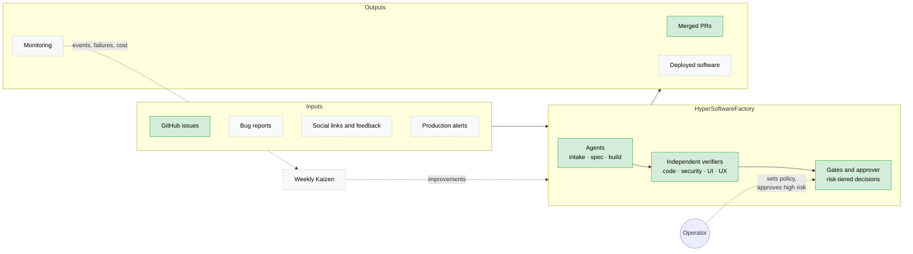
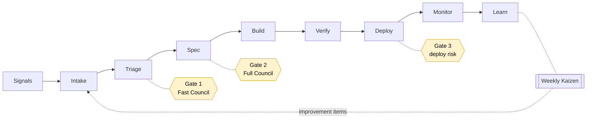

<div align="center">

# 🏭 HyperSoftwareFactory

**A software factory for building, verifying, and merging software with AI agents, and a reference architecture for where it is going.**

[](LICENSE)
[](factory/LICENSE)
[](requirements.txt)
[](https://claude.com/claude-code)
[](https://github.com/harry738/HyperSoftwareFactory/issues)
<br>
[](reference/binley/pilot-report-2026-11-21.md)
[](#autonomy-levels)
[](#roadmap)
[](https://github.com/harry738/HyperSoftwareFactory/commits/main)

[Summary](#summary) · [Working factory](#the-working-factory) · [Roadmap](#roadmap) · [Architecture](#target-architecture) · [Autonomy](#autonomy-levels) · [Contributing](#contributing)

</div>

---

## Summary

HyperSoftwareFactory turns work requests into reviewed, merged pull requests with a team of AI agents, and earns more autonomy only as measured jobs prove it safe.

- **Today:** a GitHub issue labelled `factory` goes through intake, spec, build, a deterministic gate, independent reviewers (code, security, UI, UX) and an approver. Each issue becomes one PR, which is merged, sent back for changes, or escalated to a human.
- **Tomorrow:** raw signals (social links, bug reports, feedback, alerts) come in, and deployed, monitored software goes out, with council gates on risky decisions and a weekly Kaizen loop that improves the factory from its own event log.
- **The principle:** no unreviewed output, evidence over "PASS", hard caps on loops and spend, and secrets kept outside the sandbox.

### The vision



<sub>Green: working today. Dashed: target architecture, not built yet.</sub>

> **Status.** Two things live here:
> - **A working factory** in `factory/` and `.claude/`: issue → intake → spec → build → gate → review → approve → merge. It has run one pilot job on one project ([pilot report](reference/binley/pilot-report-2026-11-21.md)).
> - **A target architecture** in `reference/`: signal intake, council gates, deploy, monitoring, and Kaizen. Those parts are not built. The [build plan](reference/build-plan.md) says what exists, what is next, and how to tell each step is done.

---

## The working factory

`factory/` and `.claude/` are the factory as it runs today on the Binley Building Society demonstrator (a fictional reference case). `/factory run` takes every open issue labelled `factory` through intake → spec → build → gate → review → approve, one PR per issue, with state in `factory/jobs/` and `factory/bin/job` as its only writer.


- **Install into a project:** copy `factory/` and `.claude/` into the target repo, then write the project's checks into `factory/checks.sh` (it fails until you do) and set `protected_paths`, `dev_server` (the command the UI and UX reviewers browse, `{port}` filled in; Next.js by default, drop it if there are no pages), models and prices in `factory/config.json`. Intake reads what belongs in the project from its `AGENTS.md` or `CLAUDE.md`. Binley's `checks.sh` and `config.json` are in `reference/binley/` as a worked example.
- **Dashboard:** `cd factory && python -m http.server`, then open http://localhost:8000/dashboard.html. A live board of every job by stage, with gate and reviewer verdicts, cost and time, and each job's files in a drawer.
- **Every project in one dashboard:** from this repo, `python scripts/factory-dashboard.py`, then open http://localhost:8020/. One tab and one board per project in `config/projects.yaml`; each tab shows how many jobs are running and how many wait on you. A project's board needs `path:` set to its local checkout (the one with `factory/` in it).
- **Windows:** the scripts carry patches marked `# binley:` (see `factory/bin/proc.py` and `factory/test_factory.py`). Setup notes are in [`reference/binley/running-the-factory.md`](reference/binley/running-the-factory.md).
- **Evidence so far:** 11 jobs on Binley by 22 Nov 2026. The pilot was merged by hand after a Windows gate fault; in the first overnight run the factory merged one PR itself, sent one job back for a CHANGES round, and escalated five to a human, as designed. No job has failed the gate yet. See the [pilot report](reference/binley/pilot-report-2026-11-21.md).

## Roadmap

The factory earns autonomy one level at a time, on measured jobs, not on features shipped. Each step below has an exit criterion in the [build plan](reference/build-plan.md); do not start a step until the one before it has exited.

| Step | Goal | Autonomy | Status |
|---|---|---|---|
| 0 | Repo hygiene: docs, licences, project-neutral install | – | Mostly done; finish the items under *Now* |
| 1 | Make the skeleton reliable: merge rule, git sign-in, per-job time and USD caps, branch protection | L1 | In progress: 11 jobs run, with a CHANGES round and escalations; still needs a gate failure and the caps |
| 2 | Deterministic backpressure: complexity delta, secret scan and dependency audit in `checks.sh` | L1 | Not started |
| 3 | Verification you can trust: evidence rule, reviewers can't change the branch, spec-only tester, security reviewer exercised | L2 | Partly in code: reviewer browser and one shared dev server |
| 4 | Isolation and concurrency: dedicated clone with no deploy secrets, daily budget, `concurrency` 2 then 3 | L2 | Partly in code: job lock waits, child processes die with the script |
| 5 | Risk-tiered merge and deploy: path-based risk floor, LOW merges unattended, HIGH always stops, deploy with rollback | L3 | Not started |
| 6 | Second project, external intake, event log, weekly Kaizen report, councils if the data asks for them | L4 | Not started |

### Now

- **Finish making the agents project-neutral.** `approver.md`, `reviewer-ui.md` and `reviewer-ux.md` still name Binley's fictional label, demo bar and audience.
- **Import the factory's permission rules.** Binley's `.claude/settings.json` holds the rule that lets `factory/bin/job merge` run unattended (proven on 22 Nov). It was not part of the import, so a fresh install stops at `approve`.
- **Close the protected-path gap.** `factory/bin/gate` checks modified and deleted files only, so a new file under a protected glob (a new `.github/workflows/*.yml`) passes. The approver caught both cases on 22 Nov; the gate should.
- **Bring back Binley's later hardening:** sensitive-path routing to the security reviewer and the `## Evidence` requirement for reviews (Binley #65, after the import).
- **Step 1 exit:** one job that fails the gate, then the per-job time and USD caps (S1.7).

### Later

Parallel builders within one spec, council gates, Prometheus metrics, microVM isolation, Context7 and Modern Web Guidance are deferred until the data calls for them. The build plan says what would trigger each.

## Contents

| Path | What's in it |
|---|---|
| [`factory/`](factory/) | The working factory: `bin/job` (state machine), `bin/gate`, `bin/route`, `bin/frontier`, `checks.sh`, `config.json`, live `dashboard.html` |
| [`.claude/agents/`](.claude/agents/) | Factory agents: intake, spec-writer, builder, code/security/UI/UX reviewers, approver |
| [`.claude/skills/`](.claude/skills/) | `factory` skill (`/factory run`) plus vetted, pinned skills (to-spec, to-tickets, tdd, deslop, ...) |
| [`reference/binley/`](reference/binley/) | First real use: pilot report, bootstrap prompt, how to run it on Windows |
| [`reference/`](reference/) | Target architecture, build plan, planned integrations |
| [`config/`](config/), [`scripts/`](scripts/) | Project registry (`projects.yaml`, local and gitignored; `projects.example.yaml` shows its shape) and its onboarding script |

## Project registry

```bash
pip install -r requirements.txt
python scripts/factory-onboard.py --interactive
```

The registry is `config/projects.yaml`. It is gitignored, because this repo is public and the registry names your projects and paths on your machine; [`config/projects.example.yaml`](config/projects.example.yaml) shows its shape. The script adds a project to it and writes draft roadmap files and a `README.md` to `onboarding/<slug>/` for you to review and push to the project repo. The README follows [`config/README.template.md`](config/README.template.md): a two-line pitch, a few honest badges, a quick start, a Mermaid architecture diagram, roadmap and contributing sections. It pushes nothing itself. The repo check needs an authenticated GitHub CLI (`gh auth login`). The working factory is installed per project and does not read this registry; only `scripts/factory-dashboard.py` does, to find each project's board.

## Target architecture



8 stages, 3 council gates, 1 weekly Kaizen review, 5 security boundaries.

| Document | What it covers |
|---|---|
| [Reference architecture](reference/software-factory-reference-architecture.md) | Stages, gates, verification, security, observability |
| [Build plan](reference/build-plan.md) | What exists, what is next, exit criteria per step |
| [Multi-project architecture](reference/factory-multi-project-architecture.md) | How one factory serves many project repos |
| [Context7](reference/context7-docs-mcp.md), [Modern Web Guidance](reference/modern-web-guidance-google-mwg.md) | Planned build-floor integrations |

## How The Target Is Designed To Work

### Signal intake
Social links, bug reports, customer feedback, and alerts enter a triage queue and are routed to a project. External content is untrusted: it is summarised by a tool-less model call before any agent that can write code sees it.

### Council gates (2 tiers)
- **Fast Council** (Chair only) — triage and medium-risk verdicts
- **Full Council** (Chair, Strategist, Pragmatist, Builder) — architecture review

Council verdicts are advisory. High-risk changes always need the operator's approval.

### Build floor
An approved spec is built by Claude Code in an isolated worktree, following a playbook per task type (bug → reproduce → investigate → fix → verify; feature → spec → test → implement), with at most 3 review-fix cycles. Parallel subagents come later and only on disjoint modules.

### Independent verification
Verifiers run in a separate job with read-only tokens, so they cannot modify the code they review:
- **Tester** — writes tests from the spec only, never from the implementation
- **Code Reviewer** — standards + spec compliance
- **Anti-Slop Lint** — lint rules + complexity delta
- **Security Scanner** — supply chain, credentials, egress
- **Behavioural Verifier** — runs the change as a user would

### Security boundaries

| Boundary | What it blocks |
|---|---|
| **Isolation** | Agent can't touch the host or other projects |
| **Egress** | Default-deny, allowlist only |
| **Supply chain** | Unapproved package hosts denied |
| **Credentials** | Real secrets never enter the agent sandbox |
| **Budget** | Hard USD/token/time cap per run, pinned model versions |

### Observability and Kaizen
Every stage transition appends one event row. A weekly review reads failures, cost, cycle time, and escape rate from that log and mints improvement items.

## Hard Constraints

1. **No unreviewed output** — every PR is reviewed by at least one independent verifier
2. **Evidence-based verification** — a bare "PASS" is treated as INCONCLUSIVE
3. **Anti-slop gate** — a complexity increase above 50% on touched files blocks the PR for architecture review
4. **Max 3 review-fix loops** — prevents infinite agent cycles
5. **All secrets stay outside the sandbox**

The target is to enforce these by the platform (branch protection, token scopes, runner budgets), not by agent instructions. The working factory enforces 1 and 4 in its scripts today.

## Autonomy Levels


| Level | What runs without you | Earned by |
|---|---|---|
| **L1** | Build to PR; you review every PR | Build plan Step 1 |
| **L2** | Build + checks + verifiers | Step 3 |
| **L3** | Low-risk merge and deploy | Step 5 |
| **L4** | Intake to deploy for low-risk work; you set policy | Step 6 |

The working factory has the machinery for L2 and an approver that can merge. On evidence it is working toward L1: it has merged a PR unattended, but the Step 1 exit is not met.

## Planned Integrations

None of these is wired in yet, and their claims are the vendors' own.

| Tool | Stage | What it provides |
|---|---|---|
| **Context7** (Upstash) | Build | Current, version-specific library docs via MCP |
| **Modern Web Guidance** (Google Chrome) | Build + Verify | Web platform best practices, Baseline-aware |
| **Crawl4AI** | Intake research | JS-rendered page extraction |

## Development

```bash
python scripts/test_factory_onboard.py   # self-check for the onboarding script
python factory/test_factory.py           # factory script checks; run inside a Node project after `npm ci`
```

## Contributing

1. Read the [reference architecture](reference/software-factory-reference-architecture.md) and the [build plan](reference/build-plan.md)
2. Open an issue to discuss your proposed change
3. Submit a PR

## Origin

Synthesised from public material on agentic software development: Factory.ai, Claude Code, Islo's security architecture, Matt Pocock's skills, Lauren Tan's Poteto Mode, and Dexter Horthy's talk on software factories.

**License:** [MIT](LICENSE), except `factory/`, `.claude/agents/` and `.claude/skills/factory/`, which are GPLv3 (see [`factory/LICENSE`](factory/LICENSE); from zazencodes-season-3 `src/software-factory-claude-code-v2`, with local patches). Vendored skills keep their own MIT licences in `.claude/skills/`.
