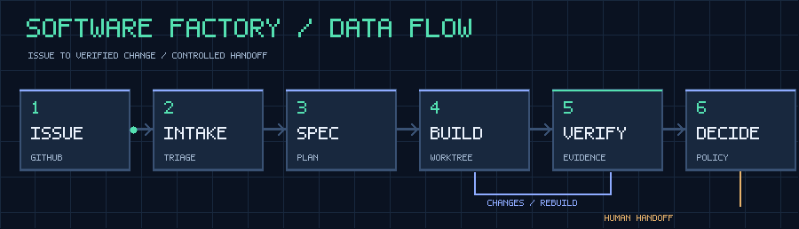
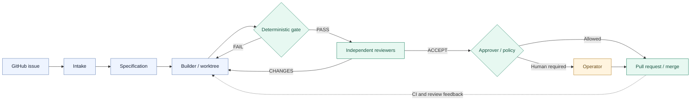
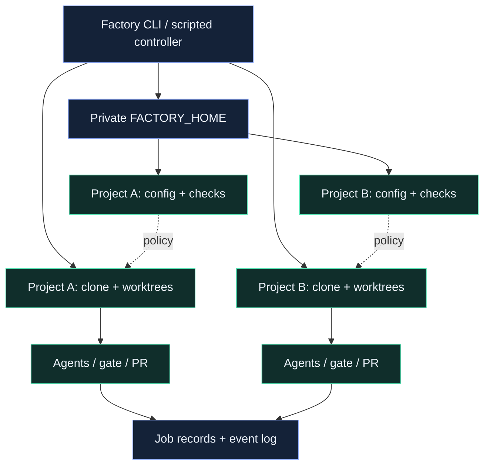
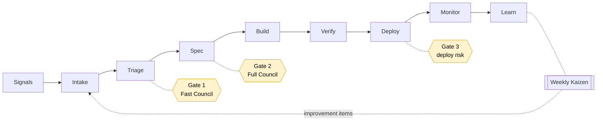
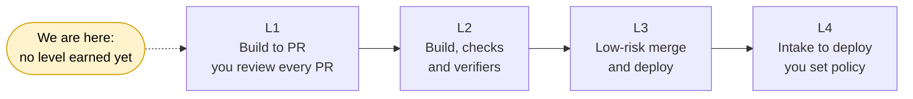

<div align="center">

<p align="center"></p>

<p align="center"></p>

<p align="center"><sub>Illustrative factory floor. Merge decisions remain subject to project policy and operator approval.</sub></p>

# HyperSoftwareFactory

**An open-source, agent-driven software factory. Governed by code. Verified with evidence.**

Convert labelled GitHub issues into scoped changes, independently reviewed pull requests and operator-controlled decisions, across projects from one central factory.

[](https://github.com/harry738/HyperSoftwareFactory/actions/workflows/tests.yml)
[](reference/build-plan.md)
[](requirements.txt)
[](LICENSE)
[](factory/LICENSE)

[Overview](#overview) · [Quick start](#quick-start) · [Workflow](#the-working-factory) · [Roadmap](#roadmap) · [Architecture](#target-architecture) · [Contribute](#contributing)

</div>

> [!IMPORTANT]
> **Working pilot, not a production-autonomy claim.** The central runner has passed end-to-end tests using GitHub and model stand-ins, but its first run on a real project remains open. Binley is a fictional demonstrator. Container isolation, Dev council, deploy/rollback and external signal intake are planned. [Current implementation status](reference/build-plan.md).

## Overview

HyperSoftwareFactory is a **central control plane for agent-assisted software delivery**. A deterministic script owns orchestration; specialist agents write and review changes; project-defined gates and policy control outcomes.

<div align="center">



<sub>Illustrative flow. The scripts and state machine define actual job transitions.</sub>

</div>

| **Build deliberately** | **Verify independently** | **Earn autonomy** |
| :--- | :--- | :--- |
| One issue, one pull request and one persisted job record. | Deterministic checks and routed code, security, UI and UX review. | Bounded rework, budget limits, policy decisions and measured evidence. |

**Implemented in code:** central CLI, worktrees, headless agents, risk/path routing, stage, job and daily budgets, checks, read-only reviews, PR feedback and append-only events. **Not yet proven:** the full central runner on a real project, hardened isolation, live deployment and autonomous operations.

## Quick start

**Requirements:** Python 3, Git, a signed-in GitHub CLI (`gh`), a signed-in Claude Code CLI, bash (and `lsof` on Linux) and a target repository with useful tests and CI. The source is free, although model/API execution may incur costs. Linux/WSL is the current engine target; Docker packaging is planned.

```bash
git clone https://github.com/harry738/HyperSoftwareFactory.git
cd HyperSoftwareFactory
python -m pip install -r requirements.txt

export FACTORY_HOME="$HOME/factory-home"
python factory/bin/factory onboard your-org/project-alpha
```

Onboarding creates a private project clone, configuration and readiness checklist. **Before running**, implement `$FACTORY_HOME/projects/project-alpha/checks.sh` (the template fails until configured), review `config.json` and its protected/sensitive paths and budgets, and enable required CI and branch protection. Provide `AGENTS.md` or `CLAUDE.md` and `CONTEXT.md` in the project repository. Keep the private factory home **outside public repositories**.

Label an issue `factory`, then:

```bash
python factory/bin/factory run project-alpha       # queued issues
python factory/bin/factory run project-alpha 42    # issue #42
python factory/bin/factory status project-alpha    # jobs and progress
```

**Supervised by default:** `unattended_merge` is `false` in the factory template. Operator approval and target-repository branch protection still matter. An operator-selectable FullAuto mode is described in the [build plan](reference/build-plan.md#fullauto-mode); it should not be mistaken for validated production capability.

## The working factory

The scripted loop (`factory/bin/run`) invokes headless agent sessions; `factory/bin/job` manages durable job transitions. The engine owns GitHub API operations, while agent stage environments are stripped of GitHub tokens.



**Recovery:** gate failures and reviewer-requested changes trigger bounded repair (three rounds by default); risk policy can hand work to the operator. A reviewer verdict alone does not override protected paths or required CI. Reviewers have read-only tools and the engine checks the branch is unchanged after review (the UI and UX reviewers still run `node`, which can write elsewhere). These limits are tested with stand-ins only, and host and network sandboxing is still to do.

### Central multi-project model



Project rules stay outside the builder's worktree. This is a **logical separation**, not a claim of container-enforced isolation.

### Dashboard and development checks

```bash
bash scripts/test.sh

cd factory
python -m http.server --bind 127.0.0.1 8000
# Open http://localhost:8000/dashboard.html
```

That single-board page shows a per-repo install only. `python scripts/factory-dashboard.py` serves every project in one dashboard (http://localhost:8020/): a tab per project in `config/projects.yaml` and in the factory home (`$FACTORY_HOME`), each with its job board and its pull requests, read with a signed-in `gh`. Restart it after onboarding a project. CI runs the same `scripts/test.sh` entry point; Windows-specific tests are skipped on other systems. Central runner integration tests use stand-ins.

## Roadmap

**Evidence so far.** All from Binley, the fictional demonstrator. The first run (to 22 Nov 2026) was 11 jobs at about $2.50 each: ten merged, one rejected at intake. The factory merged one PR itself and a person merged nine, eight of them after the approver escalated under the project's always-stop rules. A second run on 23 Nov put 18 more jobs through for $90.15. This shows the mechanism works, not that it can be trusted: Binley has no production and no users. See the [pilot report](reference/binley/pilot-report-2026-11-21.md) and [what Binley validated](reference/build-plan.md#what-binley-validated).

The objective is one factory that takes signals to deployed, verified, monitored software across the operator's own projects, with the operator setting policy. Binley tested whether the idea works; it does, and it is closed.

The [build plan](reference/build-plan.md) sets how it gets there: a central factory, deployed as a container on local Docker Desktop, with Claude Code as the development engine and a script, not a model, in charge of the loop. The core engine is built first on a three-week timebox; features follow one at a time. What the factory may do without the operator is earned separately, on measured jobs on a real project.

| Engine track | Goal | Status |
|---|---|---|
| E1 | Factory home, `factory onboard`, and `factory run` taking one job end to end on the first real project | E1.1–E1.5 done, tested with stand-ins; E1.6, the first real job, is open |
| E2 | Per-stage time, turn and cost caps, stall kill, retry, the event log, a feedback loop from the PR, a spec hand-off, and a stop when CI never starts | E2.1–E2.6 done, tested with stand-ins |
| E3 | Always-stop rules and the path-based risk floor in scripts, a council slot in the state machine, a gate with the build cache off, and a re-run for flaky checks | E3.1–E3.4 done, tested with stand-ins; E3.5 (flaky checks) is open |
| E4 | Read-only reviewers, a branch-unchanged check, evidence on the PR, follow-up issues, a send-back for a missing review | E4.1–E4.5 done, tested with stand-ins |
| E5 | Concurrency, a daily budget, a scheduled run, and merge-main rounds when the base moves | E5.2 (daily budget) done, tested with stand-ins; the rest is open |
| E6 | Network allowlist, the container, removal of the old per-repo path, and a read-only web console | E6.1 and E6.2 (allowlist and container) done, not yet run signed in; E6.3 and E6.4 are open |

Then the features, in order:

1. **Dev council**, in shadow mode: a multi-model council that debates any job that would otherwise come to the operator, and earns merge power by agreeing with the operator's own decisions.
2. **Hermes**: scheduled runs and notifications.
3. **Weekly Kaizen, inside view**: a report from the event log, and a learnings file per project.
4. **Weekly Kaizen, outside view**: a market watch and an active competitor list per project.
5. **Holdout checks**: tests the builder never sees.
6. **Deploy and rollback.**
7. **A second project.**
8. **Other external intake.**

Alongside these, **FullAuto mode**: an option the operator selects for one job (a label), one run (a flag) or a whole project, under which no job waits for a person. The engine would merge by rule and by a model's judgment inside a policy the operator writes, revert a merge that breaks the base branch, and widen or narrow what it allows itself from its own record. **None of it is built yet.** The [build plan](reference/build-plan.md#fullauto-mode) has the parts and their order.

### Now

E1.6: the first job on the first real project. The commands exist; it needs the factory home, the project token, a signed-in Claude Code CLI and a few labelled issues. Every job stops for the operator.

### Not building

Steering a run mid-flight, other models for the builder or reviewers, a merge queue, a webhook server, a mobile app. The build plan says why.

## Contents

| Path | What's in it |
|---|---|
| [`factory/`](factory/) | The working factory: `bin/job` (state machine), `bin/gate`, `bin/route`, `bin/frontier`, `checks.sh`, `config.json`, `settings.example.json`, live `dashboard.html` |
| [`.claude/agents/`](.claude/agents/), [`.claude/hooks/`](.claude/hooks/) | Factory agents: intake, spec-writer, builder, code/security/UI/UX reviewers, approver; a hook that blocks hand merges |
| [`.claude/skills/`](.claude/skills/) | `factory` skill (`/factory run`) plus [vetted, pinned skills](.claude/skills/README.md) (to-spec, to-tickets, tdd, deslop, ...) |
| [`reference/binley/`](reference/binley/) | The idea validation, now closed: pilot report, bootstrap prompt, how to run it on Windows |
| [`reference/`](reference/) | Build plan, [feature comparison](reference/feature-comparison.md) against other systems, [competitor list](reference/competitors.md), the vision architecture, planned integrations |
| [`config/`](config/) | Examples: the project registry's shape, the README template, and `self.example/`, this repo's own factory config |
| [`scripts/`](scripts/) | Registry wizard, multi-project dashboard, `test.sh` |
| [`docs/`](docs/) | README images and archived READMEs |
| [`AGENTS.md`](AGENTS.md), [`CONTEXT.md`](CONTEXT.md) | Rules for changing this repo; what the product is and its hard rules |

## Project registry

```bash
pip install -r requirements.txt
python scripts/factory-onboard.py --interactive
```

The registry is `config/projects.yaml`. It is gitignored, because this repo is public and the registry names your projects and paths on your machine; [`config/projects.example.yaml`](config/projects.example.yaml) shows its shape. The script adds a project to it and writes draft roadmap files and a `README.md` to `onboarding/<slug>/` for you to review and push to the project repo. The README follows [`config/README.template.md`](config/README.template.md): a two-line pitch, a few honest badges, a quick start, a Mermaid architecture diagram, roadmap and contributing sections. It pushes nothing itself. The repo check needs an authenticated GitHub CLI (`gh auth login`). Neither way of running the factory reads this registry (the central factory lists `$FACTORY_HOME/projects/`); only `scripts/factory-dashboard.py` does, to find the boards of per-repo installs.

`factory onboard` replaces this wizard for the central factory. The registry stays in use for per-repo installs on the multi-project dashboard.

## Target architecture

**Design direction, not live deployment:** external signals, council decisions, deployment, monitoring and Kaizen remain target-state capabilities. Dashed diagram paths signify planned control/feedback.




8 stages, 3 council gates, 1 weekly Kaizen review, 5 security boundaries. This is the longer-term vision; where it differs from the [build plan](reference/build-plan.md) (for example on the [Dev council](reference/build-plan.md#f1--dev-council-in-shadow)'s seats), the build plan wins.

| Document | What it covers |
|---|---|
| [Reference architecture](reference/software-factory-reference-architecture.md) | The vision: stages, gates, verification, security, observability |
| [Build plan](reference/build-plan.md) | Operating model, engine track, evidence track, features in order |
| [Multi-project architecture](reference/factory-multi-project-architecture.md) | How one factory serves many project repos |
| [Context7](reference/context7-docs-mcp.md), [Modern Web Guidance](reference/modern-web-guidance-google-mwg.md) | Planned build-floor integrations |

## How The Target Is Designed To Work

### Signal intake
Social links, bug reports, customer feedback, and alerts enter a triage queue and are routed to a project. External content is untrusted: it is summarised by a tool-less model call before any agent that can write code sees it.

### Council gates (2 tiers)
- **Fast Council** (Chair only) — triage and medium-risk verdicts
- **Full Council** (Chair, Strategist, Pragmatist, Builder) — architecture review

Council verdicts are advisory. High-risk changes always need the operator's approval.

### Build floor
An approved spec is built by Claude Code in an isolated worktree, following a playbook per task type (bug → reproduce → investigate → fix → verify; feature → spec → test → implement), with at most 3 review-fix cycles. Parallel subagents come later and only on disjoint modules.

### Independent verification
Verifiers run in a separate job with read-only tokens, so they cannot modify the code they review:
- **Tester** — writes tests from the spec only, never from the implementation
- **Code Reviewer** — standards + spec compliance
- **Anti-Slop Lint** — lint rules + complexity delta
- **Security Scanner** — supply chain, credentials, egress
- **Behavioural Verifier** — runs the change as a user would

### Security boundaries

| Boundary | What it blocks |
|---|---|
| **Isolation** | Agent can't touch the host or other projects |
| **Egress** | Default-deny, allowlist only |
| **Supply chain** | Unapproved package hosts denied |
| **Credentials** | Real secrets never enter the agent sandbox |
| **Budget** | Hard USD/token/time cap per run, pinned model versions |

### Observability and Kaizen
Every stage transition appends one event row. A weekly review reads failures, cost, cycle time, and escape rate from that log and mints improvement items.

## Hard Constraints

1. **No unreviewed output** — every PR is reviewed by at least one independent verifier
2. **Evidence-based verification** — a bare "PASS" is treated as INCONCLUSIVE
3. **Anti-slop gate** — a complexity increase above 50% on touched files blocks the PR for architecture review
4. **Max 3 review-fix loops** — prevents infinite agent cycles
5. **All secrets stay outside the sandbox**

The target is to enforce these by the platform (branch protection, token scopes, runner budgets), not by agent instructions. The working factory enforces 1, 2 and 4 in its scripts today.

## Autonomy Levels



| Level | What runs without you | Earned by |
|---|---|---|
| **L1** | Issue to approved PR; you merge | Ten measured jobs on a real project |
| **L2** | As L1, with reviewers you have measured | Twenty jobs reviewed blind against the reviewers |
| **L3** | Merge for the LOW tier, defined by path | The Dev council agreeing with you over twenty jobs, then twenty LOW-tier merges with no escape |
| **L4** | Signal to deploy for the LOW tier; you set policy | L3 sustained for four weeks |

Levels are per project and earned on a real one, so none is earned yet: Binley showed the mechanism works, including one unattended merge, but no real project has run a job. Always-stop rules by label and path outrank every level. Levels are the default, supervised mode; FullAuto mode is the operator's switch to skip the wait. The [build plan](reference/build-plan.md) has the full criteria.

## Planned Integrations

None of these is wired in yet, and their claims are the vendors' own.

| Tool | Stage | What it provides |
|---|---|---|
| **Context7** (Upstash) | Build | Current, version-specific library docs via MCP |
| **Modern Web Guidance** (Google Chrome) | Build + Verify | Web platform best practices, Baseline-aware |
| **Crawl4AI** | Intake research | JS-rendered page extraction |

## Development

```bash
bash scripts/test.sh
```

This is the supported test entry point and is also used by CI. It runs Python script tests, including the central runner with stand-ins; Windows-specific tests are skipped on non-Windows systems. See [AGENTS.md](AGENTS.md) for the conventions.

## Contributing

1. Read [`AGENTS.md`](AGENTS.md), the [reference architecture](reference/software-factory-reference-architecture.md) and the [build plan](reference/build-plan.md)
2. Open an issue to discuss your proposed change
3. Submit a PR

## Origin

Synthesised from public material on agentic software development: Factory.ai, Claude Code, Islo's security architecture, Matt Pocock's skills, Lauren Tan's Poteto Mode, and Dexter Horthy's talk on software factories.

**License:** [MIT](LICENSE), except `factory/`, `.claude/agents/` and `.claude/skills/factory/`, which are GPLv3 (see [`factory/LICENSE`](factory/LICENSE); from zazencodes-season-3 `src/software-factory-claude-code-v2`, with local patches). Vendored skills keep their own MIT licences in `.claude/skills/`.
