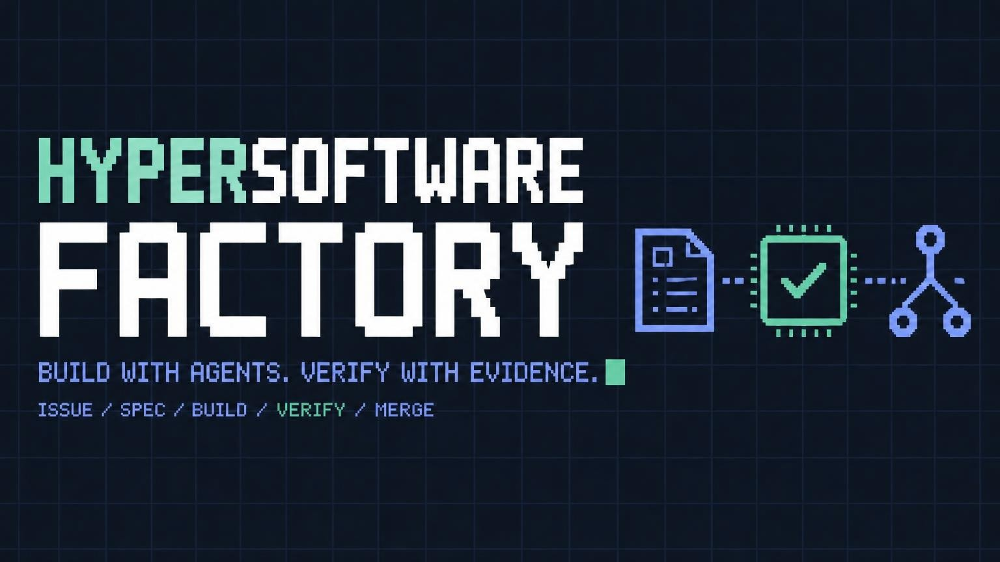
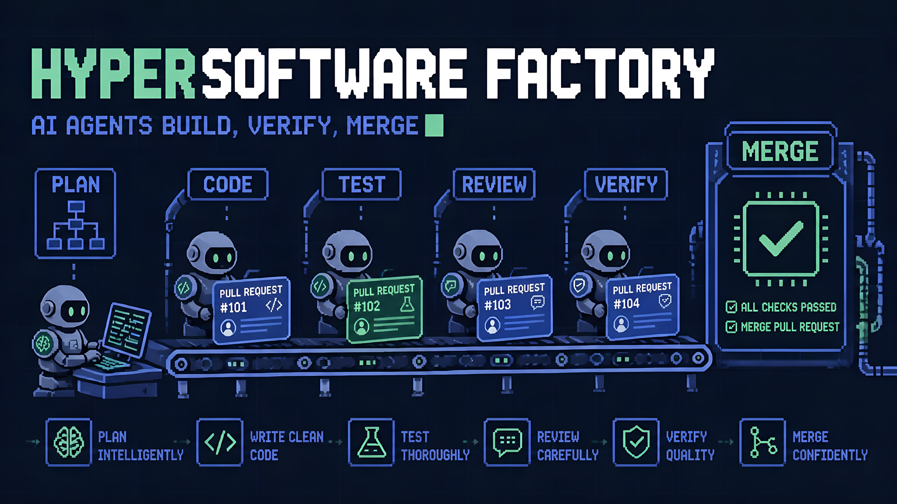
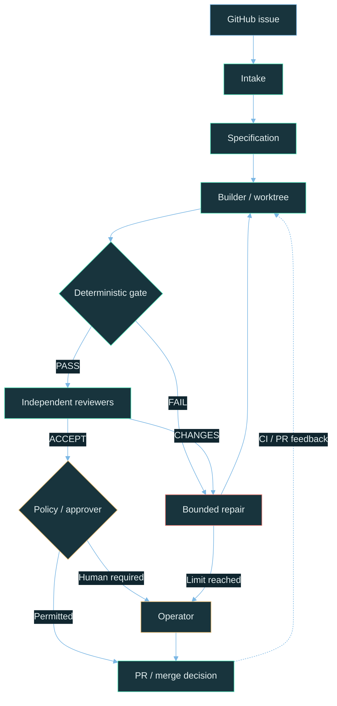
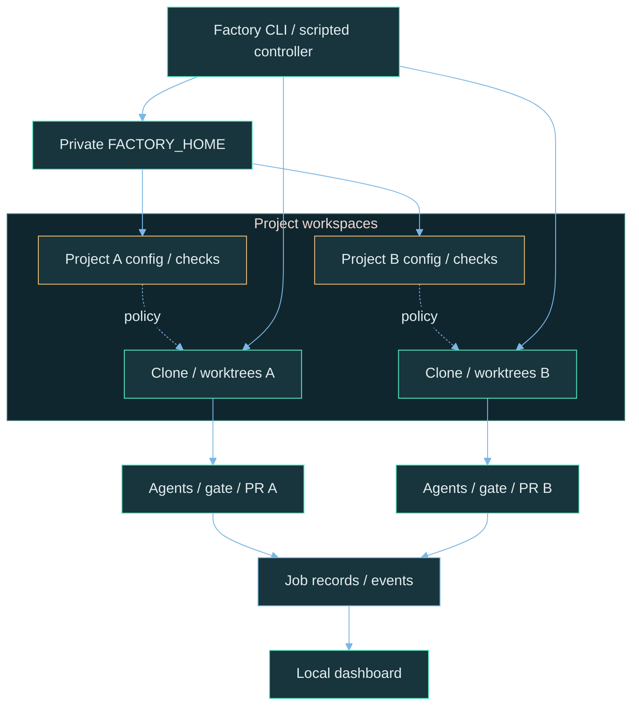
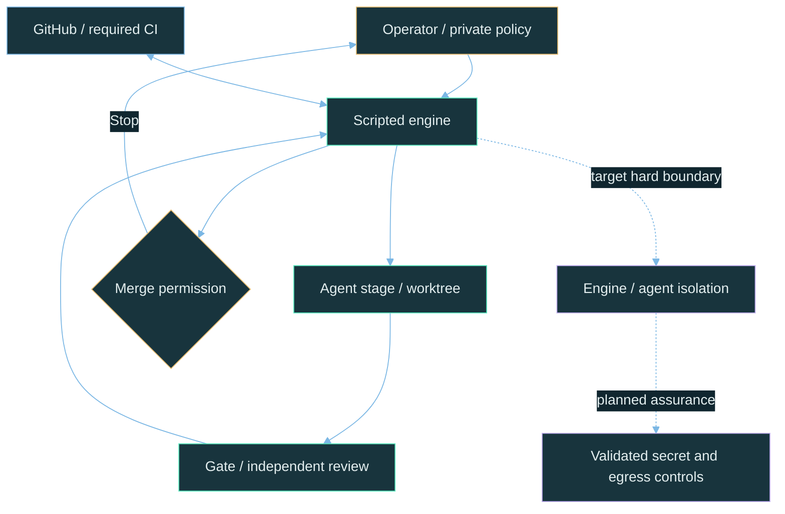
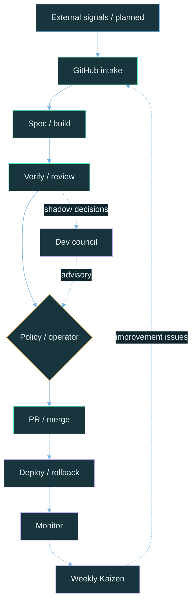
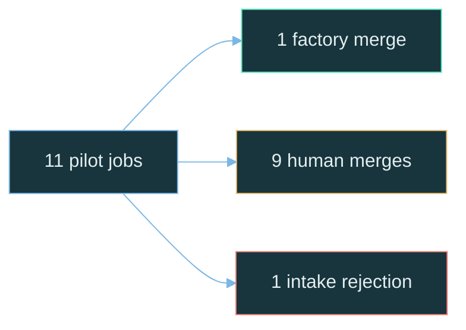
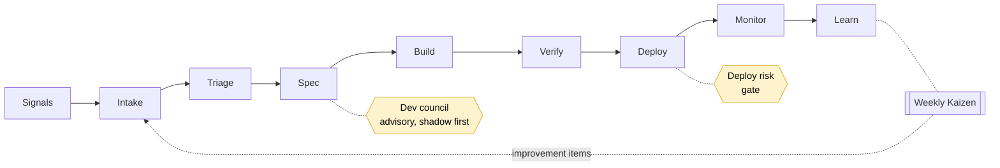

<div align="center">



# HyperSoftwareFactory

**Build with agents. Verify with evidence.**

**An open-source, self-hosted software factory that turns GitHub issues into independently verified pull requests.**

Orchestrate specialist AI agents, enforce engineering standards, control costs and govern delivery across projects from one central control plane.

[](https://github.com/harry738/HyperSoftwareFactory/actions/workflows/tests.yml)
[](reference/build-plan.md)
[](INTEGRATIONS.md)
[](requirements.txt)
[](LICENSE)
[](factory/LICENSE)

[Quick start](#quick-start) · [Onboard with Skill](SKILL.md) · [Capabilities](#factory-capabilities) · [Architecture](#how-it-works) · [Evidence](#evidence-and-performance) · [Roadmap](#roadmap)



<sub>Factory-floor illustration. Merge remains subject to policy, checks and operator approval.</sub>

</div>

> [!IMPORTANT]
> **Supervised pilot.** The central runner has passed end-to-end tests with GitHub and model stand-ins. Its first signed-in run on a real project remains open. The Docker image and network proxy have been locally tested; hard engine/agent separation, Dev council, deployment, rollback and external intake remain incomplete or planned. [Build plan and current status](reference/build-plan.md).

## See the factory

<div align="center">

<br/>
<sub>Conceptual animation, not a recording of the running software.</sub>
</div>

**See the evidence:** [Binley pilot report](reference/binley/pilot-report-2026-11-21.md) · [Reproduce the tests](#development) · [Run the local dashboard](#control-room).

Real recordings of issue-to-PR execution, the control room and failed-gate recovery are outstanding. [Demonstration capture plan](docs/demo-capture-plan.md).

## The problem

Coding agents can generate software quickly. They do not, by themselves, provide a governed software delivery lifecycle.

| Challenge | Factory approach |
|---|---|
| Agents drift from requirements | Structured specs and acceptance criteria |
| Code is generated and self-approved | Separate builder and independent reviewers |
| Tests or quality controls can be weakened | Deterministic checks and project policy outside the builder worktree |
| Unpredictable execution costs | Stage, job and daily budgets |
| Multiple repositories are difficult to operate | Central CLI and multi-project dashboard |
| Human approval becomes a bottleneck | Evidence-based, progressive autonomy (planned) |
| Failures recur without learning | Event evidence and planned weekly Kaizen |

The factory is not another coding assistant. It is the control plane around coding assistants: **scripts own the workflow; agents perform bounded tasks; evidence and policy govern decisions.**

## Quick start

| Human onboarding | Agent-assisted onboarding |
|---|---|
| Follow the commands below on Linux/WSL. | Give your coding agent [SKILL.md](SKILL.md) and ask it to guide you through a supervised first run. |

**Requirements:** Python 3, Git, bash, lsof on Linux, authenticated GitHub CLI, installed and signed-in Claude Code, and a project with meaningful tests and required CI. Model execution may incur costs.

```bash
git clone https://github.com/harry738/HyperSoftwareFactory.git
cd HyperSoftwareFactory
python -m pip install -r requirements.txt

export FACTORY_HOME="$HOME/factory-home"
python factory/bin/factory onboard your-org/project-alpha
```

Onboarding creates a private clone and project configuration. Before running:

1. Implement the project's `checks.sh` under `$FACTORY_HOME/projects/project-alpha/` (the template deliberately fails).
2. Review `config.json`, protected/sensitive paths, budgets and base branch; keep `unattended_merge: false`.
3. Provide `AGENTS.md` or `CLAUDE.md` and `CONTEXT.md` in the project. Enable required CI and branch protection.
4. Keep the factory home and credentials outside public repositories.

Label a small issue `factory` with acceptance criteria. Then run:

```bash
python factory/bin/factory run project-alpha 42
python factory/bin/factory status project-alpha
# Process the project's queue when ready:
python factory/bin/factory run project-alpha
```

Replace 42 with your issue number. Review checks, PR evidence and the operator decision before merging. No packaged pip CLI or production-ready FullAuto is claimed.

### Control room

```bash
python scripts/factory-dashboard.py
# Open http://localhost:8020/
```

The local read-only dashboard shows a board per project from the private factory home or legacy registry, plus GitHub PRs using authenticated gh. Restart after onboarding. The container-hosted web console remains planned. [Use cases](USE_CASES.md).

## Factory capabilities

<table>
<tr><td width="50%"><b>01 / ORCHESTRATE</b><br/>Central CLI, durable job state, GitHub issue intake, bounded retries.<br/><sub>Implemented; stand-in tested</sub></td><td width="50%"><b>02 / ENGINEER</b><br/>Specifications, headless Claude Code, per-job worktrees, project context.<br/><sub>Implemented; stand-in tested</sub></td></tr>
<tr><td><b>03 / VERIFY</b><br/>Deterministic gates, independent code/security/UI/UX review, PR evidence.<br/><sub>Implemented; stand-in tested</sub></td><td><b>04 / GOVERN</b><br/>Risk/path routing, approval rules, cost/time caps, protected paths.<br/><sub>Implemented; hard isolation incomplete</sub></td></tr>
<tr><td><b>05 / OPERATE</b><br/>Local project dashboard, job status and append-only events.<br/><sub>Implemented; web console planned</sub></td><td><b>06 / IMPROVE</b><br/>Dev council, holdout checks, Kaizen, market watch, earned autonomy.<br/><sub>Planned</sub></td></tr>
</table>

**Status language:** implemented means code exists, not that a real project has proved it. Pilot evidence is from the fictional Binley demonstrator; stand-in tests verify scripted behaviour, not model quality or production security.

[Configuration and detailed implementation status](reference/build-plan.md) · [Security and residual risks](SECURITY.md) · [Use cases](USE_CASES.md)

## Integration ecosystem

| Current | Validated in part | Planned / research |
|---|---|---|
| Claude Code, GitHub / gh, Git, Python, bash | Docker image and network proxy | Hermes, Context7, Modern Web Guidance, Crawl4AI, multi-model Dev council |
| Local multi-project dashboard | Central runner stand-in tests | Prismor (candidate assessment only) |

[Full integration matrix](INTEGRATIONS.md). Claude Code is the current development engine; alternative builder runtimes are not supported.

## How it works

### 01 / The working factory



The deterministic runner owns orchestration; `factory/bin/job` is the state writer. The engine performs GitHub operations, and agent stages run without GitHub tokens in their stage environment. Checks and reviewer-requested changes trigger bounded rework (three rounds by default). A reviewer verdict cannot override required CI or protected paths. The default supervised posture requires operator approval.

### 02 / Central multi-project control plane



Project configuration is outside the builder worktree. This is logical separation, not a guarantee of host or tenant isolation. A second real project is a roadmap milestone.

### 03 / Security and trust boundaries



| Enforced / implemented | Incomplete / target |
|---|---|
| Script-owned transitions, external checks, label/path policy, bounded repair, scoped review tools and branch-unchanged checks | Hard engine/agent user separation; production-validated host and secret isolation; complexity gate |
| Docker image/proxy tested locally | Signed-in end-to-end container run |
| Append-only events and PR evidence | Stronger audit integrity and independent holdout assurance |

Some UI/UX reviewer tools can still write outside the worktree. Worktrees are not sandboxes. [Security guidance](SECURITY.md) · [Hard rules](CONTEXT.md).

### 04 / Target lifecycle



Dashed links indicate target functionality. The [build plan](reference/build-plan.md) takes precedence over the [reference architecture](reference/software-factory-reference-architecture.md) where they differ.

## Evidence and performance

<div align="center">

| 29 | 10 | ~$2.50 | $90.15 |
| :---: | :---: | :---: | :---: |
| Jobs across two demonstrator runs | Merged PRs in first run | First-run agent cost per job | Agent cost for second run (18 jobs) |

</div>

**First run, by 22 Nov 2026:** 11 jobs; ten merged (one by the factory, nine by people), one rejected at intake. Eight of the human merges followed policy escalations. **Second run, 23 Nov:** 18 jobs; 15–90 minutes per job at concurrency 1.



Binley is a fictional demonstrator with no production deployment or users. The pilot validated the earlier mechanism, not production autonomy or the new central engine on a real project. Only the first job has a written pilot report. [Pilot report](reference/binley/pilot-report-2026-11-21.md) · [Build plan: what Binley validated](reference/build-plan.md#what-binley-validated).

### What we will measure

| Dimension | Metric |
|---|---|
| Velocity | Issue-to-PR cycle time |
| Quality | First-pass verification and defect escape |
| Economics | Agent cost per verified change |
| Reliability | Job completion, retries and failures |
| Autonomy | Human intervention and policy escalation |
| Effectiveness | Acceptance criteria coverage |
| Improvement | Change in outcomes over time |

These are proposed scorecard metrics, not claimed measurements. Event-log automation is future work.

## Autonomy and governance

Autonomy is earned **per project**, through measured work on a real project. None has been earned yet.

| Level | Capability | Evidence threshold |
|---|---|---|
| L1 | Issue to approved PR; operator merges | Ten measured real-project jobs |
| L2 | Measured independent verification | Twenty jobs independently assessed against reviewers |
| L3 | Low-risk merge | Council agrees with operator over twenty jobs, then twenty low-risk merges without escape |
| L4 | Low-risk signal to deploy | L3 sustained four weeks |

FullAuto is a planned operator-selected alternative, not built. Hard policy boundaries and required checks must still apply. [Autonomy criteria and FullAuto](reference/build-plan.md#fullauto-mode).

## Target architecture

Design direction, not live deployment. Signals, council decisions, deployment, monitoring and Kaizen are target-state capabilities. The [build plan](reference/build-plan.md) decides what is built and what comes next.



Eight stages, two gates, one weekly Kaizen review, and five security boundaries.

| Document | What it covers |
|---|---|
| [Reference architecture](reference/software-factory-reference-architecture.md) | The vision: stages, gates, verification, security, observability |
| [Build plan](reference/build-plan.md) | Operating model, release sequence, engine tasks, decisions |
| [Multi-project architecture](reference/factory-multi-project-architecture.md) | How one factory serves many project repositories |
| [Context7](reference/context7-docs-mcp.md), [Modern Web Guidance](reference/modern-web-guidance-google-mwg.md) | Planned build-floor integrations |

### Dev council

A Chair and three seats (Architect, Risk and Product), drawn from different model vendors, debate a job that would otherwise go to the operator. It starts in shadow mode: it records a verdict, and the operator's decision still counts. It earns merge power only after it has agreed with the operator for long enough. Until then its verdicts are advisory, and always-stop rules outrank them.

### Signal intake

Social links, bug reports, customer feedback and alerts enter a triage queue and are routed to a project. External content is untrusted, so a tool-less model call summarises it before any agent that can write code sees it.

### Build and independent verification

An approved spec is built by Claude Code in an isolated worktree, following a playbook for each task type. The build gets at most three review-fix cycles. Verifiers run as a separate job with read-only tokens, and their checkout is mounted read-only, so they cannot change the code they review. A read-only token alone does not stop local file writes: a tester writes tests from the spec alone, a reviewer checks standards and the spec, a lint check looks at complexity, a scanner covers supply chain, credentials and egress, and a behavioural verifier runs the change as a user would.

### Security boundaries

| Boundary | What it blocks |
|---|---|
| **Isolation** | An agent touching the host or other projects |
| **Egress** | Any destination not on the allowlist |
| **Supply chain** | Unapproved package hosts |
| **Credentials** | Real secrets entering the agent sandbox |
| **Budget** | Runs exceeding a hard USD, token or time cap, and unpinned model versions |

### Observability and Kaizen

Every stage transition appends one event row. A weekly review reads failures, cost, cycle time and escape rate from that log and records improvement items.

## Hard constraints

1. **No unreviewed output.** Every PR is reviewed by at least one independent verifier.
2. **Evidence-based verification.** A bare "PASS" counts as inconclusive.
3. **Anti-slop gate.** A complexity increase above 50% on touched files blocks the PR for architecture review.
4. **A bounded round budget.** Each job starts with three review-fix rounds (`max_rounds` in `factory/config.json`). Operator feedback grants a fresh budget. This stops agent cycles from running forever.
5. **Secrets stay outside the sandbox.**

The target is to enforce these by the platform (branch protection, token scopes, runner budgets) rather than by agent instructions. The working factory enforces the round budget and the evidence rule in its scripts today.

## Use cases

| Scenario | What to inspect |
|---|---|
| Deliver a small feature or bug fix | Spec, tests, reviews and PR |
| Recover from a failed check | Gate output, bounded rework and stop |
| Escalate a protected or sensitive change | Policy decision and human handoff |
| Operate multiple projects | Local boards and PR status |

[Walkthroughs and commands](USE_CASES.md).

## Roadmap

One roadmap: the [build plan](reference/build-plan.md), v6.6. It sets the release sequence, the decisions taken and the engine tasks. The release names and exit criteria are summarised here.

**Now: R1, the reliable factory.** First the fail-closed merge default, then CI classification, the PR policy and serial merging. E1.6, the first job on a real project, needs the operator.

| Release | Focus | Exit |
|---|---|---|
| R1 Reliable | First real run, fail-closed merge, CI classification, bounded checks, isolation, PR policy | Ten supervised jobs, including a seeded gate failure, a CHANGES round and a runaway-stage kill |
| R2 Verified | Specification contract, holdout tests, commit-bound evidence, project standards | Every accepted criterion has evidence |
| R3 Scalable | Durable scheduler, concurrency, second project, conflict resolution | Three concurrent jobs across two projects |
| R4 Delivery | Hermes, operations console, deploy and rollback | One issue reaches healthy staging |
| R5 Learning | Knowledge packs, Kaizen, the shadow Dev council, the provider layer | Measured improvement against a baseline |
| R6 Autonomous | FullAuto, LOW-tier unattended merge, market watch, external intake | Per-project evidence gates met |

Autonomy levels L1–L4 are earned per project on real jobs and are defined in the build plan.

This is a product summary, not a change to the delivery order. Alternative builders, mid-run steering, a merge queue, webhook server and mobile app are not in scope.

## Documentation

| Guide | Purpose |
|---|---|
| [Onboard with Skill](SKILL.md) | Safe agent-assisted central onboarding |
| [Use cases](USE_CASES.md) | Workflows and commands |
| [Integrations](INTEGRATIONS.md) | Current, planned and candidate components |
| [Security](SECURITY.md) | Trust boundaries and residual risk |
| [Build plan](reference/build-plan.md) | Authoritative implementation roadmap |
| [Reference architecture](reference/software-factory-reference-architecture.md) | Target design, security and observability |
| [Multi-project architecture](reference/factory-multi-project-architecture.md) | One factory, many repositories |
| [Competitor analysis](reference/feature-comparison.md) | Comparative research |
| [Brand system](docs/brand/brand-system.md) | Documentation, diagram and dashboard conventions |
| [Demo capture plan](docs/demo-capture-plan.md) | Real product recording backlog |
| [Archived README](docs/archive/README-2026-11-25.md) · [Original rendered location](https://github.com/harry738/HyperSoftwareFactory/blob/351b660f8c53e8a79003ffd746bfa9d34be74c20/README.md) | Exact pre-redesign source; use the historical root link for working relative links |

### Repository map

| Path | Purpose |
|---|---|
| [factory/](factory/) | Engine CLI, state machine, gates, routing and dashboard |
| [.claude/agents/](.claude/agents/) | Specialist agent definitions |
| [.claude/skills/](.claude/skills/) | Legacy per-repo factory skill and vetted skills |
| [config/](config/) | Example registry, self configuration and README template |
| [scripts/](scripts/) | Tests, dashboard server and legacy registry wizard |
| [deploy/](deploy/) | Docker and network proxy |
| [reference/](reference/) | Build plan, research and Binley pilot |
| [docs/](docs/) | Brand, assets and archived documentation |

The legacy `python scripts/factory-onboard.py --interactive` wizard remains available for the per-repo registry, not the central engine. Central onboarding uses `factory onboard`; only the dashboard reads the legacy registry.

## Development

```bash
python -m pip install -r requirements.txt
bash scripts/test.sh
```

CI uses the same test entry point. The central runner is tested with stand-ins for GitHub and Claude; Windows-only tests are skipped elsewhere. See [AGENTS.md](AGENTS.md) for repository conventions.

## Contributing

Read [AGENTS.md](AGENTS.md), [CONTEXT.md](CONTEXT.md) and the [build plan](reference/build-plan.md). Open an issue to discuss changes, then submit a PR with evidence. Follow the [brand standard](docs/brand/brand-system.md) for diagrams and documentation. Never disclose private projects, local paths or secrets.

## Origin and license

Synthesised from public work on agentic software development, including Factory.ai, Claude Code, Islo, Matt Pocock's skills, Lauren Tan's Poteto Mode and Dexter Horthy's software-factory talk.

**License:** [MIT](LICENSE), except `factory/`, `.claude/agents/` and `.claude/skills/factory/`, which are GPLv3 (see [factory/LICENSE](factory/LICENSE); from zazencodes-season-3 `src/software-factory-claude-code-v2`, with local patches). Vendored skills keep their own MIT licences.

<div align="center"><b>BUILD WITH AGENTS. VERIFY WITH EVIDENCE.</b></div>
