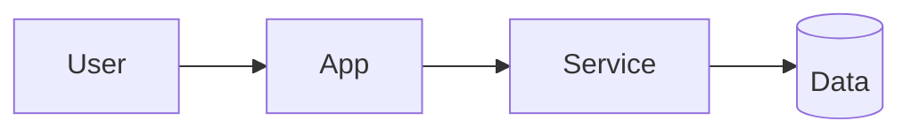

<!--
  README pattern for projects onboarded to the factory.
  Order follows common practice in well-kept open source repos:
  pitch in two lines, a few honest badges, a visual, a quick start
  that works in under a minute, then depth. Delete any section you
  can't fill with real content: an empty section reads worse than none.
  Keep badges to ones that are true today (no CI badge without CI).
-->
<div align="center">

# $name

**One sentence: what $name does and who it is for.**

[](LICENSE)
[](https://github.com/$repo/commits)
[](https://github.com/$repo/issues)
[](https://github.com/harry738/HyperSoftwareFactory)

[Overview](#overview) · [Quick start](#quick-start) · [Architecture](#architecture) · [Roadmap](#roadmap) · [Contributing](#contributing)

</div>

<!-- A screenshot or short GIF of the product goes here. -->

## Overview

Two or three sentences on the problem and why this project solves it.

- **Feature one:** what it does for the user.
- **Feature two:** what it does for the user.
- **Feature three:** what it does for the user.

## Quick start

```bash
git clone https://github.com/$repo.git
cd $slug
# install and run: the fewest commands that get a working result
```

## Architecture



## Roadmap

The roadmap lives in [`docs/product/roadmap.yaml`](docs/product/roadmap.yaml) and is managed by the factory.

| Status | Item |
|---|---|
| Done | Project setup, factory onboarding ($onboarded) |
| Next | First feature |

## Contributing

Work arrives as GitHub issues. Label an issue `factory` to have the factory pick it up; every change lands as a reviewed PR.

1. Open an issue describing the change
2. Discuss scope and acceptance criteria
3. Submit or review the PR

## License

See [LICENSE](LICENSE).
